# Signal to Response: A Map of the Human Interaction Loop

> Where a device can actually intervene between the world and a human response — and where it cannot.

This document exists because SYMBORG kept answering a design question ("what should an assistive interface return, and when?") without ever writing down the system it was intervening in. This is that system: the path a signal takes from the physical world, through the senses, into the brain, to conscious access, to intention, and back out as an action.

For each stage we give its approximate **latency**, its **information throughput** where a defensible number exists, and — most importantly — whether a device can **act there today**, is **research-stage**, or **cannot act there at all**.

Numbers are drawn from primary literature and were checked by an independent adversarial pass; where a widely-quoted figure turned out to be a misattribution or an overstatement, the corrected value is used and flagged. Ranges are given honestly. Nothing here is a medical claim.

---

## 1. The shape of the problem: an hourglass

The single most consequential fact about this loop is that it narrows brutally in the middle.

```
   SENSORY INPUT              CONSCIOUS ACCESS           SPOKEN OUTPUT
   10^7 – 10^9 bit/s   ──►      ~10 – 60 bit/s      ──►    ~39 bit/s
   ▓▓▓▓▓▓▓▓▓▓▓▓▓▓▓▓▓            ▓                          ▓▓
```

Estimates of raw sensory bandwidth run to hundreds of millions of bits per second. The rate at which a person can consciously report, decide, and act is roughly **10 bit/s** ([Zheng & Meister, *Neuron*, 2024](https://doi.org/10.1016/j.neuron.2024.11.008)). Natural speech carries about **39 bit/s** of semantic information, and — strikingly — this holds near-constant across 17 languages regardless of syllable rate ([Coupé et al., *Science Advances*, 2019](https://doi.org/10.1126/sciadv.aaw2594)).

**The bottleneck is neither the senses nor the muscles. It is in the middle.**

The design consequence is direct, and it is the thesis of this repository: the value of an assistive interface is not in how much information it can gather, but in **what it declines to send through that narrow gate**. An interface that increases input pressure on a saturated channel makes the person slower, not faster.

---

## 2. The loop, stage by stage

```mermaid
flowchart LR
  A["Stimulus<br/>0 ms"] --> B["Receptor<br/>&lt;1–40 ms"]
  B --> C["Peripheral nerve<br/>5–20 ms"]
  C --> D["Thalamic gate<br/>10–30 ms"]
  D --> E["Primary cortex<br/>15–70 ms"]
  E --> F["Association cortex<br/>60–150 ms"]
  F --> G["Salience / affect<br/>75–150 ms"]
  G --> H["CONSCIOUS ACCESS<br/>250–400 ms"]
  H --> I["Intention<br/>−1500 ms"]
  I --> J["Language production<br/>175–455 ms"]
  J --> K["Motor pathway<br/>6–100 ms"]
  K --> L["Action<br/>~600 ms"]
  L -.->|"feedback · efference copy"| A
```



| # | Stage | Latency | Throughput | Can a device act here? |
|---|---|---|---|---|
| 1 | **Physical stimulus** — sound, light, touch, before the body | 0 ms | device-limited | ✅ **Today** — the easiest place to speak |
| 2 | **Sensory transduction** — hair cell, photoreceptor, mechanoreceptor | <1–40 ms | very high, contested | ✅ **Today** — cochlear implant, retinal implant |
| 3 | **Peripheral nerve conduction** | 5–20 ms | ~10² bit/s per axon | ✅ **Today** — VNS, spinal stim, FES |
| 4 | **Thalamic gate** — all senses but smell pass here | 10–30 ms | does not add bandwidth | ⚠️ Research (direct) · ✅ Today (indirect, via attention) |
| 5 | **Primary sensory cortex** — V1 / A1 / S1 | 15–70 ms | — | ⚠️ Research — cortical microstimulation |
| 6 | **Association cortex** — feed-forward sweep | 60–150 ms | — | ⚠️ Research |
| 7 | **Salience filter & affective tagging** | 75–150 ms | near-scalar "gain" | ✅ Today (indirectly, by directing attention) |
| 8 | **Conscious access** — global broadcast | 250–400 ms | **~10–60 bit/s** | ❌ **No content can be written here** |
| 9 | **Intention / decision** | −1500 to −400 ms | negligible readout | ⚠️ Research |
| 10 | **Language production** — concept → word → phonology | 175–455 ms | ~2–3 lemmas/s | ⚠️ Research — intracortical speech prostheses |
| 11 | **Motor pathway & muscle** | 6–100 ms | — | ✅ Today — FES, surface EMG decoding |
| 12 | **Action & feedback** — speech, gesture, gaze | ~600 ms to first sound | ~39 bit/s | ✅ Today |

**A note on stage 4.** Only 5–10% of synapses in the lateral geniculate nucleus carry retinal input; 90–95% are modulatory. The thalamus is not a relay — it is a gate whose setting is controlled from elsewhere. This is why *directing attention* is a cheap, non-invasive way to change what reaches cortex, and why implanting an electrode there is not the only option.

**A note on stage 9.** Readiness potentials precede voluntary movement by up to 1.5 s, a finding widely misreported as "the brain decides before you do". The predictive value is near-zero in practice: roughly 60% accuracy on a two-alternative choice (chance = 50%), inside an MRI scanner. It is not productisable, and the popular framing should not be repeated.

---

## 3. Channel bandwidth: why the sensory route wins

The intuition that putting an electrode closer to the brain buys more bandwidth is **backwards**. The channels nearest the brain are the narrowest ones.

| Channel | Measured throughput | Invasiveness |
|---|---|---|
| **Writing via the native sensory channel** (audio / visual / haptic) | **~40–60 bit/s** | none |
| Natural speech (reference) | ~39 bit/s | — |
| Tactile — Tadoma (human ceiling) | ~22 bit/s | none |
| Tactile — engineered devices | 5–12 bit/s | none |
| SSVEP EEG speller (non-invasive ceiling) | ~2.8–5.3 bit/s | none |
| P300 speller | ~0.3 bit/s | none |
| Cortical V1 phosphenes (visual prosthesis) | ~0.1–1 bit/s | implant |

In words-per-minute, for interfaces used by people who cannot speak:

| Interface | Rate |
|---|---|
| Natural speech | 150–190 wpm |
| Intracortical speech prosthesis | 56–78 wpm |
| Eye-tracking + language model | 20–30 wpm |
| Surface EMG handwriting decoding | ~21 wpm |
| Eye-tracking, unaided baseline | ~8 wpm |

**Cochlear implants are the proof.** They are the only genuinely scaled clinical success at writing information into the nervous system — around one million implanted — and they work by *imitating the natural sensory pathway* rather than bypassing it. Choosing the sensory route is not a compromise forced by lack of resources. On today's numbers it is the best available option, by one to two orders of magnitude.

---

## 4. The power budget: can a body-powered chip run a local LLM?

A recurring proposal in this space is an implanted chip, powered by body energy, running a language model. The arithmetic settles it.

```
Harvested in vivo (glucose biofuel cell, best reported)   ≈  39 µW
Energy per token (1B-parameter model, edge device)        ≈  52–271 mJ

39 µW × 3600 s  =  140 mJ  →  roughly ONE TOKEN PER HOUR

Conversational rate (10 tokens/s)  ≈  1.4 W  →  ~36,000× the harvest
```

Thermoelectric harvesting from skin yields on the order of 8–72 µW/cm² depending on movement and airflow — the same order of magnitude. Wireless power does not rescue it either: within electromagnetic safety limits, the power deliverable to a deep-tissue implant is on the order of **90 µW** — pacemaker territory.

And a second wall does not yield to better engineering: **heat**. The limit on how much power an implant may dissipate into tissue is set by physiology, not by circuit design.

**The answer is no.** But the useful answer is *where the computation should live instead* — a layered budget:

| Layer | Power | What runs there |
|---|---|---|
| **0 — Implant** | 10 µW – 1 mW | Sensing and stimulation only. Pacemaker architecture. No model. |
| **1 — Always-on gatekeeper** | 1–10 mW | Voice activity, keyword spotting; decides when to wake layer 2 |
| **2 — Wearable accelerator** | 30–150 mW | The real neural network: speech separation, enhancement. Commercially proven. |
| **3 — Phone** | 1–10 W, **bursty** | Local small LLM, orchestration. Never continuous — thermal throttling is real. |
| **4 — Cloud** | unbounded | Large models. Send *compressed meaning*, not raw audio. |

The last row carries a design rule worth stating: since speech conveys ~39 bit/s of meaning, transmitting semantics rather than audio is roughly **3–4 orders of magnitude cheaper** in radio energy. The most valuable thing an on-body model does is decide what *not* to transmit.

---

## 5. Which condition breaks which link

Mapping a condition to the exact link it severs determines which intervention can possibly help.

| Condition | Broken link | Still intact | Consequence |
|---|---|---|---|
| **Intubation** | Vocal tract only (mechanical) | Every layer from intent to muscle | No need to touch the brain — the problem is purely at the output |
| **ALS** | Motor neurons, progressively | Cognition and language; early on, residual muscle signal | Bank the voice *before* it is lost; the input channel narrows over time |
| **Brainstem stroke / locked-in** | Corticospinal tract | Cortex, comprehension, eye movement | Selection via gaze or BCI is a valid signal of intent |
| **Aphasia** | **The language layer itself** (semantic access, word selection) | Motor system intact | Critical distinction — presenting sentences to *choose* may be invalid if comprehension is impaired |
| **Guillain-Barré** | Peripheral nerve | Cortex and cognition | Often reversible; a temporary solution may be sufficient |

The aphasia row is the one most often gotten wrong. Aphasia is not a motor problem, and an interface designed for a motor problem may not help — and could mislead — a person whose language system is what is impaired.

---

## 6. Claim discipline

Much of the vocabulary circulating around "connecting to the body's signal" is not merely imprecise — it is *undefined*, and therefore not engineerable. A quantity with no unit and no calibration procedure cannot be built on. The table below maps common phrasings to their measurable equivalents.

| Avoid | Use instead | Why |
|---|---|---|
| "the body's frequency" | **bioelectric potentials** (EEG / EMG / ECG) | The body has no resonant frequency; what is measured is voltage from ionic currents |
| "the body's WiFi" | **human body communication (HBC)** | HBC is real and standardised — it uses the body as a conductive medium, with a carrier *you* generate |
| "connecting to the signal" | **non-invasive biosignal acquisition and decoding** | There is no channel to connect to; electrodes measure leakage at the skin |
| "uploading information to the brain" | **presenting information via a sensory channel** | No upload method exists; at best you write to a natural sense |
| "changing the signal to control behaviour" | **neuromodulation** (state change, not content) | tFUS, TMS, tDCS and DBS alter excitability; none carry content |
| "reading thoughts" | **motor intent decoding** / **decoding attempted speech** | What is read are motor commands already sent toward muscle — not thought |
| "energy field / biofield" | **name the physiological parameter you measure** | A quantity without units collapses at the first technical question |
| "connecting remotely" | **contact or near-field coupling** | There is no "remote" — every method touches the patient or sits centimetres away |

**The physics, briefly.** A communication channel requires a carrier wave, a modulation scheme, addressing, and a protocol. Biological signals below ~1 kHz sit in the quasi-static regime and radiate no propagating wave; they have none of the four. Reading is possible because an electrode sits sub-millimetres from tissue. Tuning in from a distance is not, because there is no carrier to tune to.

---

## 7. What this project does not claim

- No device — invasive or not — can write semantic content into conscious experience. The obstacle is not power, electrode count, or resolution: meaning is a distributed, individually idiosyncratic, continuously changing pattern. The best implants address ~10³ channels; cortex has ~10¹⁰ neurons.
- No body-energy-powered implant can run a language model (§4).
- Intervening at the moment of word selection does not help. Within the ±100 ms window, an externally supplied word *slows* naming rather than speeding it.
- No engineering improvement gets below the human's own ~250 ms hear-and-speak floor. That bottleneck is not in the machine.
- SYMBORG is a communication aid. It is not a medical device, it does not diagnose or treat, and every choice is made by the person using it.

---

## 8. Method and limitations

This map was assembled from parallel literature surveys across six domains — the afferent pathway, central processing, the efferent pathway, write technologies, the power budget, and the latency budget — each then passed to an independent adversarial fact-checker tasked with refuting its quantitative claims. Several widely-repeated figures did not survive that pass and appear here in corrected form.

It remains a working document, not a peer-reviewed review. Ranges reflect genuine disagreement in the literature, particularly for sensory bandwidth estimates, which depend heavily on what is being counted. **Verify any figure against its primary source before using it in a public claim.**

Corrections and additions are welcome — see [CONTRIBUTING.md](../CONTRIBUTING.md).

---

### Key sources

- Coupé, Oh, Dediu & Pellegrino (2019). Different languages, similar encoding efficiency. *Science Advances* 5(9).
- Zheng & Meister (2024). The unbearable slowness of being: why do we live at 10 bits/s? *Neuron*.
- Cowan (2001). The magical number 4 in short-term memory. *Behavioral and Brain Sciences* 24(1).
- Dehaene & Changeux (2011). Experimental and theoretical approaches to conscious processing. *Neuron* 70(2).
- Indefrey & Levelt (2004). The spatial and temporal signatures of word production components. *Cognition* 92.
- Stivers et al. (2009). Universals and cultural variation in turn-taking in conversation. *PNAS* 106(26).
- Sherman & Guillery — on thalamic drivers and modulators.
- Reed & Durlach — on tactile communication bandwidth (Tadoma).
- Additional device-level sources are cited inline above.
